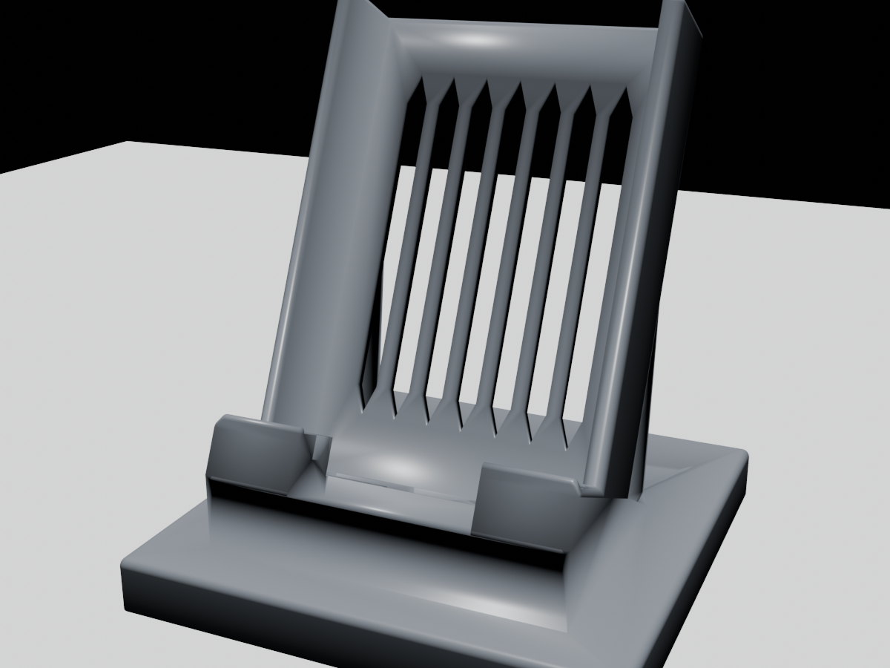
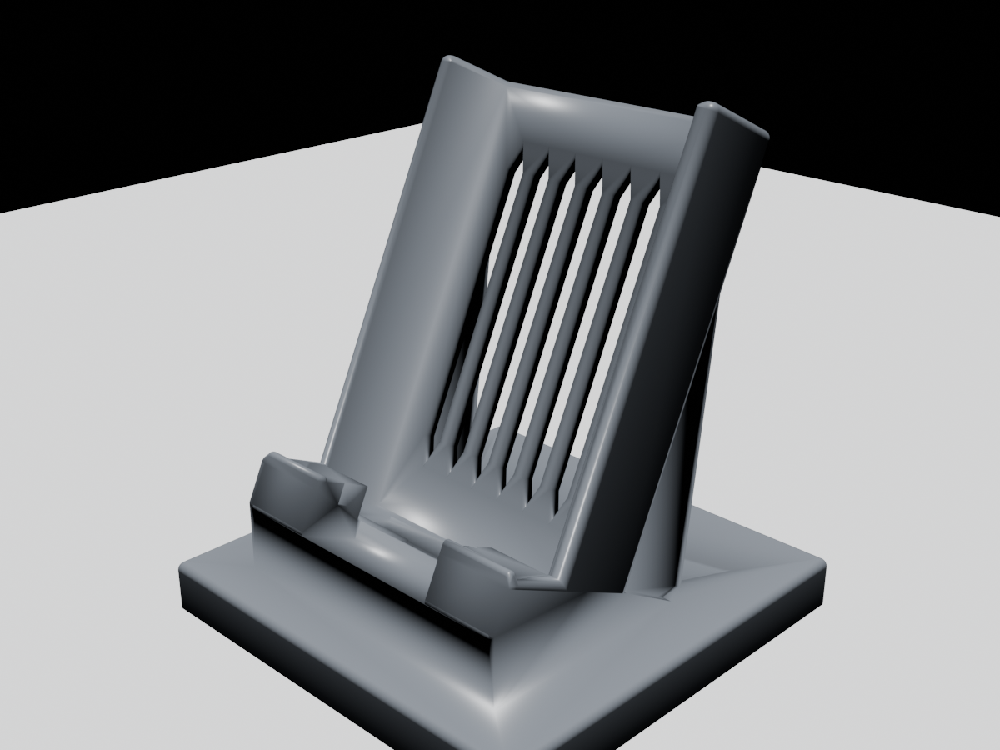
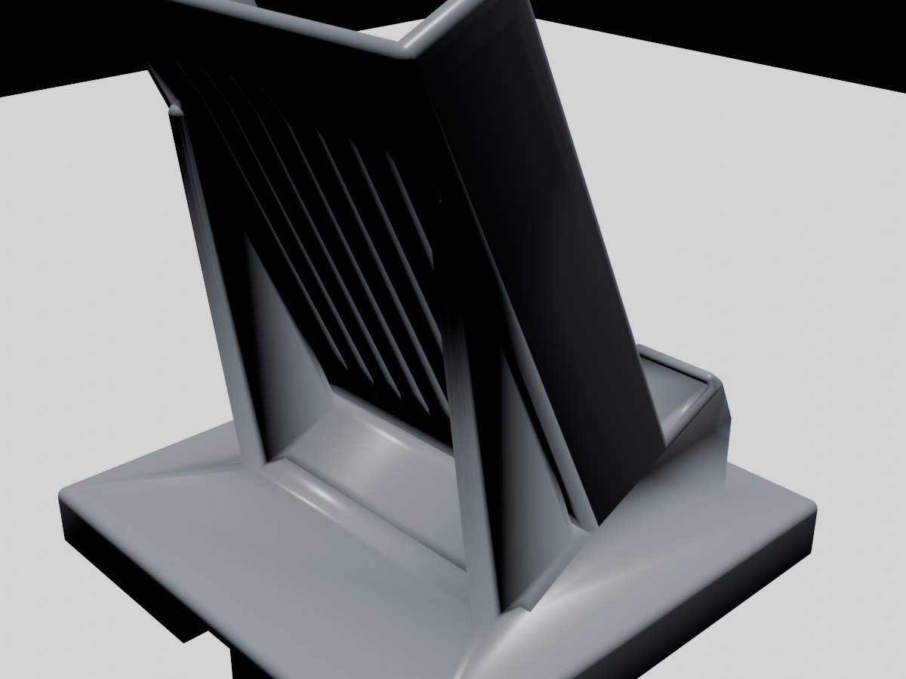

# boAt EnergyShroom PB331 + Samsung Galaxy S25 Wireless Charging Dock

A high-precision, 3D-printable parametric desktop charging stand engineered specifically to dock the **boAt EnergyShroom PB331 magnetic wireless power bank** ($108 \times 70 \times 19.5\text{ mm}$ + $1.5\text{ mm}$ raised MagSafe pad) and charge a **Samsung Galaxy S25 in a silicone MagSafe case** ($\approx 150.5 \times 74.5 \times 10.5\text{ mm}$).

Designed for single-piece, **100% support-free FDM 3D printing**, rock-solid desk stability, passive convective cooling, and zero camera-bump interference.

---

## Visual Showcase

| Front View (Pocket & Ledge) | Isometric View (Anti-Tip Stance) | Rear View (Gothic Vents & Cable Egress) |
| :---: | :---: | :---: |
|  |  |  |

---

## What's New in v1.1.0 (Hardware Alignment Updates)

* **Accounted for Additional Power Bank Depth:**
  * Real-world boAt PB331 units feature a **raised circular MagSafe charging pad and alignment tab** protruding $\approx 1.5\text{ mm}$ forward from the main casing.
  * Internal pocket depth expanded to **$20.3\text{ mm}$** ($19.5\text{ mm}$ body $+ 0.8\text{ mm}$ tolerance) so the power bank slides in effortlessly without binding.
  * Phone resting shelf depth expanded from $12.0\text{ mm}$ to **$14.0\text{ mm}$** to comfortably accommodate the cased Galaxy S25 ($10.5\text{ mm}$) resting against the protruding MagSafe pad with $2.0\text{ mm}$ margin.
* **Corrected Charging Port Location (Left-Offset USB-C):**
  * Inspection of the actual boAt PB331 confirms the USB-C input/output charging port is located on the **LEFT side of the bottom edge** at $X \approx -16.0\text{ mm}$ (not centered).
  * Floor cable slot shifted to $X = -16.0\text{ mm}$ with a generous $20.0\text{ mm} \times 11.5\text{ mm}$ pass-through channel to accommodate standard and bulky USB-C cable heads.
  * Under-base cable channel smoothly connects from $X = -16.0\text{ mm}$ out through the rear base egress.
* **Battery LED Indicator Viewing Window:**
  * The center 5 battery percentage and charging status LED indicator dots are now directly visible through the front center notch ($40.0\text{ mm}$ wide), allowing battery status checks at a glance while docked.

---

## Key Engineering Features

1. **Flush Magnetic Contact & Recessed Pocket:**
   * Recessed cradle sized at **$108.8 \times 70.8 \times 20.3\text{ mm}$** ($+0.8\text{ mm}$ print tolerance).
   * Front face of the PB331 sits flush with the front backrest, with the raised MagSafe pad standing slightly proud ($+0.8\text{ mm}$) to ensure direct, uninterrupted magnetic lock with the phone's case.
   * Smooth $45^\circ$ lead-in chamfers at the top entry rim ensure scratch-free insertion and removal.
   * Subtle dual retention friction ribs ($0.25\text{ mm}$) prevent the power bank from lifting out when peeling the phone off the MagSafe magnets.

2. **Galaxy S25 Camera Clearance:**
   * Tuned with `rim_below_phone_top = 48.0 mm`, keeping the top rim of the PB331 pocket $48\text{ mm}$ below the top of the cased phone.
   * Completely clears the Galaxy S25's triple rear camera module and silicone case protective lip above the power bank.

3. **Resting Ledge with Gesture & Port Notch:**
   * $14.0\text{ mm}$ forward shelf depth supports the $10.5\text{ mm}$ silicone case + $1.5\text{ mm}$ raised MagSafe pad offset.
   * $3.2\text{ mm}$ raised front lip holds the phone securely without encroaching onto the active screen area.
   * $40.0\text{ mm}$ central notch provides thumb clearance for upward bottom swipe navigation gestures, reveals the 5 battery LEDs, and leaves the phone's bottom microphone, speaker, and port unblocked. Solid $19.6\text{ mm}$ corner wings provide sturdy lateral support.

4. **100% Support-Free Thermal Ventilation:**
   * $55 \times 82\text{ mm}$ rear ventilation cutout directly exposes the power bank's aluminum backplate to ambient air for 15W wireless charging heat dissipation.
   * 7 vertical slots featuring steep **gothic pointed chevrons** ($>58^\circ$ overhang angle in world space). Prints **completely support-free** with zero sagging or drooping bridges.

5. **Tool-Free Pass-Through Cable Management:**
   * $20 \times 11.5\text{ mm}$ floor port accommodates standard USB-C cable heads directly under the left port ($X = -16\text{ mm}$).
   * Slopes smoothly through an angled internal transition into a $16 \times 8.5\text{ mm}$ open rear channel under the base plate. Cable can be inserted, swapped, or routed cleanly out the back without sharp kinks or tool disassembly.

6. **Anti-Tip Desk Ballast Stance:**
   * Wide footprint ($110.0\text{ mm W} \times 110.2\text{ mm D} \times 12.0\text{ mm H}$) with $2\text{ mm}$ rounded perimeter fillets and dual structural rear gusset buttresses.
   * Engineered with a $65^\circ$ ergonomic viewing angle that prevents tipping when tapping or swiping on the screen.

---

## Technical Specifications

| Parameter | Specification | Notes |
| :--- | :--- | :--- |
| **Compatible Power Bank** | boAt EnergyShroom PB331 | $108 \times 70 \times 19.5\text{ mm}$ + $1.5\text{ mm}$ raised pad |
| **Compatible Phone** | Samsung Galaxy S25 (Cased) | Up to $152 \times 76 \times 11.0\text{ mm}$ (Silicone MagSafe) |
| **Viewing Angle** | $65^\circ$ backward from desk | Ergonomic desktop viewing |
| **Internal Pocket Dimensions** | $108.8\text{ mm (H)} \times 70.8\text{ mm (W)} \times 20.3\text{ mm (D)}$ | $+0.8\text{ mm}$ tolerance included |
| **Ledge Shelf Depth & Lip** | $14.0\text{ mm}$ depth, $3.2\text{ mm}$ lip | $40.0\text{ mm}$ gesture center notch |
| **USB-C Port Location** | Left-offset at $X = -16.0\text{ mm}$ | $20 \times 11.5\text{ mm}$ drop opening |
| **Overall Footprint (W × D × H)** | $110.0 \times 110.2 \times 123.3\text{ mm}$ | Fits standard $180 \times 180\text{ mm}$ build plates |
| **Total Mesh Volume** | $217,925\text{ mm}^3$ | Watertight 2-manifold (`Volumes: 2`) |
| **Estimated PLA Mass** | $\approx 120\text{ g}$ (Standard) / $\approx 195\text{ g}$ (Ballast) | See slicing guide |

---

## Slicer & 3D Printing Recommendations

Tested and verified for Bambu Studio, PrusaSlicer, OrcaSlicer, and Cura:

* **Build Plate Orientation:** Place flat base directly on the print bed ($Z = 0$). No rotation needed.
* **Supports:** **DISABLED (0% Supports Needed)**. Every angle complies with self-supporting FDM design rules.
* **Layer Height:** `0.20 mm` Standard (or `0.16 mm` for ultra-fine edge fillets).
* **Wall Loops / Perimeters:** `4 walls` ($\approx 1.6 - 1.8\text{ mm}$ shell thickness for strong pocket rails).
* **Top / Bottom Shells:** `5 top, 4 bottom layers`.
* **Infill:** `20% Gyroid` or `25% Adaptive Cubic`.
* **Pro Desk-Stability Ballast Tip:**
  In your slicer, add a **Modifier Box** over the base plate ($Z = 0$ to $Z = 12\text{ mm}$) and set infill to **`100% Rectilinear`**. This concentrates $\approx 145\text{ g}$ of weight directly in the base plate for an unshakeable, weighted feel when placing or removing the phone.

---

## Customization in OpenSCAD

The entire design is fully parametric. Open `boAt_PB331_Galaxy_S25_Dock.scad` in [OpenSCAD](https://openscad.org/):

```openscad
// Adjust camera clearance vs magnetic alignment:
rim_below_phone_top = 48.0; // Pocket rim to phone top distance (mm)

// Adjust power bank body and raised pad depth:
pb_body_d = 19.5; // Main body thickness (mm)
pb_pad_d  = 1.5;  // Raised MagSafe circular pad protrusion (mm)
ledge_len = 14.0; // Forward shelf depth (mm)

// Adjust USB-C charging port offset:
usbc_port_x = -16.0; // Left offset (mm)

// Adjust base stance:
base_w = 110.0; // Base width (mm)
tilt   = 65.0;  // Viewing angle (degrees from desk)
```

To compile via command line:
```bash
openscad -o boAt_PB331_Galaxy_S25_Dock.stl boAt_PB331_Galaxy_S25_Dock.scad
```

---

## License

This project is licensed under the **Creative Commons Attribution-NonCommercial-ShareAlike 4.0 International (CC BY-NC-SA 4.0)** license.

You are free to:
* **Share** — copy and redistribute the material in any medium or format.
* **Adapt** — remix, transform, and build upon the material.

Under the following terms:
* **Attribution** — You must give appropriate credit to **Tumesh**.
* **NonCommercial** — You may not use the material for commercial purposes (selling prints or licensing without permission).
* **ShareAlike** — If you remix, transform, or build upon the material, you must distribute your contributions under the same license.
